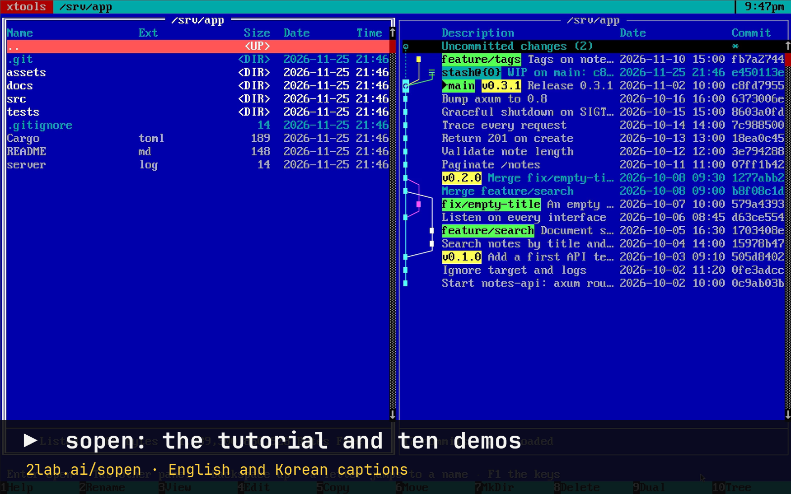
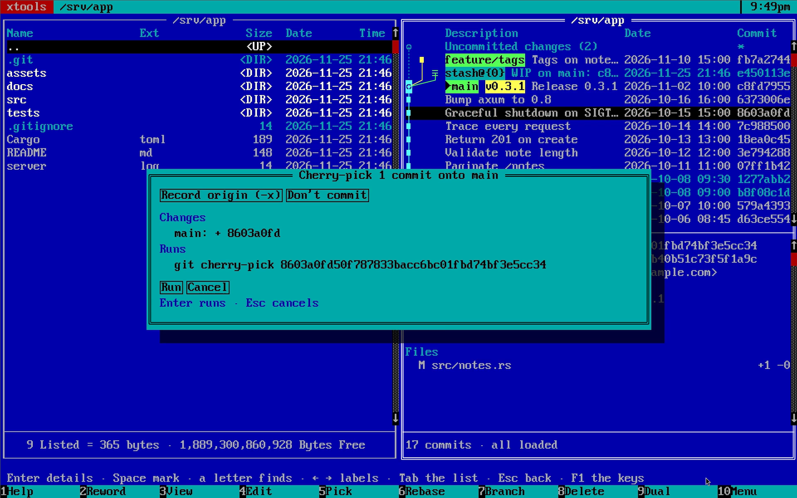
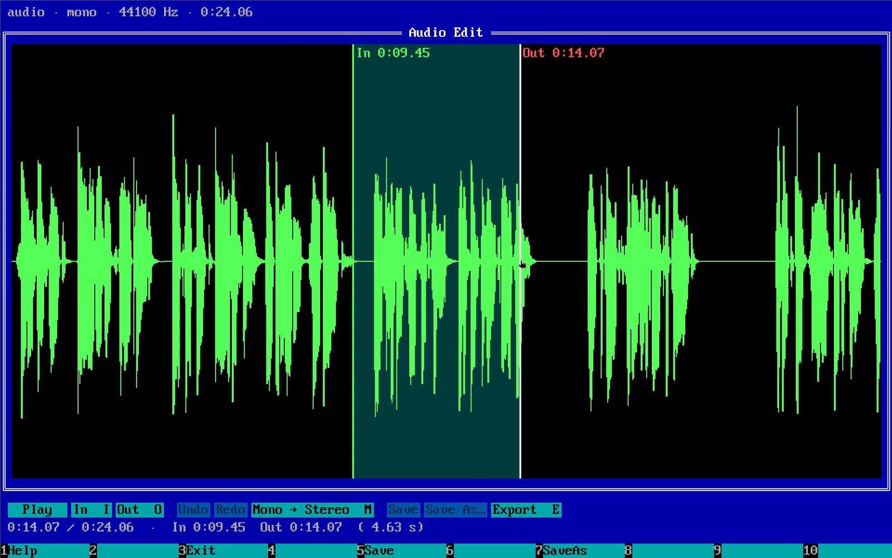

# sopen

**Open a file or folder on another machine as if it were local. Same syntax as `scp`; the remote needs only sshd.**

`sopen` is the command; xtools is the multi-function tool it opens — the file browser, the
viewers, the image, video, audio and hex editors, the git panel and the directory tree.

<p align="center">
  <a href="#streaming-any-file-however-big-opens-at-once">streaming</a> · <a href="#folders-the-file-browser-with-git">folders</a> · <a href="#images-crop-pixelize-paste-save-back">images</a> · <a href="#video-and-audio-cut-on-the-timeline-save-back">video and audio</a> · <a href="#big-and-binary-files">big files</a> · <a href="#in-the-terminal---tui">--tui</a> · <a href="#on-another-machines-screen---target">--target</a> · <a href="#from-the-command-line-sopen-cut-sopen-stems">cut and stems</a> · <a href="#install">install</a> · <a href="docs/README.md">docs</a>
</p>

[](https://www.2lab.ai/sopen)

<p align="center"><sub>▶ <a href="https://www.2lab.ai/sopen">The tutorial, the streaming comparison and ten short demos</a>, recorded on the real sopen with demo data, with English and Korean captions.</sub></p>

```sh
sopen myserver:~/project           # folder → the xtools file browser: two panels, Enter views any file
sopen --tui myserver:~/project     # the same file browser in this terminal; F12 moves it into a window and back
sopen myserver:/var/log/app.log    # text → VS Code remote (Remote - SSH), else Zed
sopen myserver:/tmp/shot.png       # image → view, rectangle crop / pixelize, cut / copy / paste, save back
sopen myserver:/tmp/talk.mp4       # video → play, cut / copy / paste, crop → save back or a new file
sopen myserver:/tmp/a.mp3          # audio → play, cut / copy / paste, mono → stereo → save back or a new file
sopen stems myserver:/tmp/a.mp3    # voice and music → two new files next to it
sopen myserver:/tmp/a.zip          # anything else → asks: hex editor (default) or save it to a path
sopen --target <host> myserver:/tmp/a.mp3   # the same, on <host>'s screen instead of this one
sopen --target <host> http://127.0.0.1:1234/  # this machine's web page in xtools on <host>, tunnelled
```

Same syntax as `scp`. Uses your `ssh` and `~/.ssh/config`; the remote needs nothing but sshd.

## Streaming: any file, however big, opens at once

[](https://www.2lab.ai/sopen#streaming)

A remote file is never copied first just to be looked at. Every viewer — video and audio, the hex
editor, the file browser's text viewer, images — reads what is on screen and a little around it,
then the rest as you move, like a video stream: however big the file, it shows at once. Measured
from one server over a link held to 100 Mbit/s:

| Opening | Copied first with `scp` | With `sopen` |
| --- | --- | --- |
| a 24 GB video | 34 min before the first frame | playing 0.5 s after Enter, 2.3 MB read; at minute 50 one second after the click |
| a 24 GB disk image, in the hex editor | 36 min | the first screen after 64 KiB; 20 GB in, 192 KiB read in all |
| a 182 MB log with a 150 MB line, in the text viewer | 15 s | the first screen after 64 KiB; line 400,001 after 32 MB |
| a 10240×5760 JPEG of 18.8 MB | 1.6 s | the whole picture 0.8 s after Enter, sharpening as the rest arrives |

<sub>The `scp` times are each file's size at the 11.4 MB/s `scp` showed on that link; the `sopen`
bytes are sopen's own stream counters. ▶ <a href="https://www.2lab.ai/sopen#streaming">The
comparison, recorded</a> on the real sopen in two Linux containers.</sub>

## Folders: the file browser, with git

```sh
sopen myserver:/srv/app        # two panels on the folder, as in Total Commander
```


<sub>Every screenshot is the real app, recorded in a Linux container with demo data under `/srv`.</sub>

Rest the bar on a file and the other side previews it; `Enter` opens it in the viewer for its kind.
`F5` / `F6` copy and move (to a `host:/path` too) and `F7` makes a folder, never over anything;
`F8` deletes, asking first. Inside a git work tree the other side is the repository's git panel:
the graph, a commit's details and diffs, and every Git Graph action, each shown in a dialog first
with the exact git command lines and the backup refs it writes before anything rewrites or
deletes; `⌘Z` undoes the newest backup. It runs the host's own `git`; nothing is installed.



The panels, the git panel, the directory tree, file operations, the text viewer and every key:
[docs/file-browser.md](docs/file-browser.md).

## Images: crop, pixelize, paste, save back

```sh
sopen myserver:/tmp/shot.png
```


Drag a rectangle, then `C` crops, `P` pixelizes, and `⌘X` / `⌘C` / `⌘V` cut, copy and paste a
picture or text into it (Ctrl on Linux). `⌘S` backs the original up locally and saves over the
remote file in the same format; `⇧⌘S` writes `<name>.edited.<ext>` next to it; `⌥⌘S` a new file on
this machine. Details: [docs/images.md](docs/images.md).

## Video and audio: cut on the timeline, save back

```sh
sopen myserver:/tmp/talk.mp4
sopen myserver:/tmp/a.mp3
```



Drag on the timeline to select a stretch; `⌘X`, `⌘C` and `⌘V` cut, copy and paste it, and playback
shows the edit at once. ffmpeg renders only when you Save — over the original, which is kept first
— or Export (`E`: `<stem>.cut-<in>-<out>.<ext>` next to it). `M` turns a mono sound into stereo; on
video a rectangle crops what Export writes. A remote file plays without being downloaded. Details:
[docs/video-audio.md](docs/video-audio.md).

## Big and binary files

```sh
sopen myserver:/srv/data/backup-2026-11.img   # a dialog first: hex editor (Enter), Save to…, Cancel
sopen --hex myserver:/srv/notes.txt           # any file straight in the hex editor
```


Anything that is not a folder, text, an image or media opens a small dialog first; nothing is
downloaded yet. `Enter` opens the hex editor at once, reading only the rows on screen — here a 24 GB
disk image, three bytes overwritten far into it. On a server with `copy-data` (OpenSSH 9.0 or
later) Save copies the file on the server, writes your changed bytes into the copy and puts it in
place of the original: a 4-byte change to a 24 GB file sends 4 bytes, not the file.


Text is read a chunk at a time too: a single 150 MB line of a log opens wrapped, from wherever you
are in it. Details: [docs/binary.md](docs/binary.md) and
[the text viewer](docs/file-browser.md#the-text-viewer).

## In the terminal: `--tui`

```sh
sopen --tui myserver:/srv/app      # the file browser in this terminal
```

![sopen --tui in a terminal: the file browser on /srv/app drawn in text cells, the folder listed on the left, "[GUI]" on the title row, and on the right, where the preview would be, a box saying "F12 shows it in the window"](screenshots/tui.png)

The same file browser in the terminal you typed it in — the same frames, colours and keys. `F12`
(or `Alt+G`, or a click on `[GUI]`) moves it into a window on this machine and back, with
everything as it was — or, with a target, into a window on that machine's screen (below).
Details: [docs/tui.md](docs/tui.md).

## On another machine's screen: `--target`

```sh
sopen --target <host> myserver:/tmp/a.html    # opens on <host>'s screen (sopen runs there, over ssh)
sopen config target <host>                    # from now on `sopen SOURCE` opens on <host>
sopen --here myserver:/tmp/a.html             # …but this one here
sopen --target <host> http://127.0.0.1:1234/  # a page served here, in xtools on <host> through an ssh tunnel
```

Type on one machine, see it on another: `<host>` runs its own installed sopen with `--here`, and
the file's remote still needs only sshd. An `http://` or `https://` address opens in an xtools
window on the machine that shows things — its scripts on (`F2` turns them off), kept to the
address's origin, a link clicked elsewhere handed to the default browser — and `sopen` returns when
the window is closed; `--browser` opens the default browser instead, as does a machine with no
display or no web engine (on Linux, until sopen's Linux web engine lands, after one line saying
so). With a target, a loopback one (`localhost`, `127.x.y.z`, `[::1]`) is served from this machine
through an ssh tunnel of its own, closed when this sopen ends or the window there is closed.

```sh
sopen --tui --target <host> ~/src   # the file browser here; F12 moves it to a window on <host>
```

From `sopen --tui` with a target, `F12` opens the window on `<host>`'s screen at the same folders,
selections, dialog and viewer, and closing it there (or `F12` there) brings the terminal back with
whatever was done in it. Meanwhile the terminal waits, dimmed; `Ctrl+C` there ends the window on
`<host>` — or leaves it open if it has unsaved edits. Unsaved edits here are asked about first
(Save, Save As…, Discard, Cancel), so is an open git dialog (it does not cross yet), and a running
copy or save is waited for. `<host>` reaches this machine's files by its own ssh.
Details: [docs/target.md](docs/target.md) and [docs/urls.md](docs/urls.md).

## From the command line: `sopen cut`, `sopen stems`

```sh
sopen cut myserver:/tmp/talk.mp4 1:05 1:20.5 --crop 0,0,1280,720
sopen stems myserver:/tmp/talk.mp3    # → talk.voice.mp3 and talk.music.mp3 next to it
sopen myserver:/srv/data.bin --app ImHex    # macOS: the app's name, as `open -a` takes it
```

`sopen cut` re-encodes the stretch from `IN` to `OUT` so it is exact and uploads it next to the
original as `<stem>.cut-<in>-<out>.<ext>`. `sopen stems` separates the voice from the music on this
machine's CPU and uploads both as new files next to the original, never over anything. `--app`
fetches a copy for any local app and uploads your changes when you press Enter. Details:
[docs/cli.md](docs/cli.md).

## What makes it work

- **Only what is on screen is read.** Remote files are never downloaded just to look at them: sopen
  reads what is on screen and a little around it, the rest as you move, like a video stream — a
  24 GB file in the hex editor shows its first screen after reading 64 KiB of it. It all comes over
  SFTP; video and audio are decoded here by ffmpeg from that stream.
- **Edits stay on this machine until Save.** Edits in the xtools image, video, audio and hex
  windows are kept on this machine until you save — in memory and, a moment later, on disk, so a
  crash loses at most that moment's — and Save writes back to the remote file, Save As to a local
  one. After a crash the next open offers them back.
- **Nothing is installed on the remote.** It needs only sshd with its SFTP subsystem (the default);
  sopen installs and runs nothing there. The git panel runs the remote's own `git` over the same
  connection and uploads nothing. Text goes to VS Code Remote - SSH or Zed, which
  install their own remote server — that is the editor's, not sopen's.
  [What the remote needs](docs/requirements.md#what-the-remote-needs).
- **Nothing is overwritten silently.** Every write first re-checks the remote file and writes
  nothing if it changed; a write goes to a temporary file that is renamed over the original.
  [Safety](docs/safety.md).

## Install

| You want | Command | Runs on |
| --- | --- | --- |
| sopen, rolling preview | `brew install 2lab-ai/tap/sopen-preview` | macOS (arm64, x86_64), Linux (x86_64, aarch64); pulls in ffmpeg |
| Build from source | `git clone https://github.com/2lab-ai/sopen && cd sopen && just build` | your checkout |

The formula also installs the model `sopen stems` uses (67 MB) and
[`THIRD-PARTY-NOTICES`](THIRD-PARTY-NOTICES). `just build` runs `cargo build --release --locked`;
the default build downloads sherpa-onnx and checks it (`SHERPA_ONNX_LIB_DIR` for offline builds).

## Requirements

- Media: `ffmpeg` and `ffprobe` (the formula installs them).
- The git panel: git 2.20 or newer where the repository is.
- `sopen stems`: its model (the formula installs it) and about 6.5 GB of memory at its peak.
- Text: VS Code (for a remote file, with its Remote - SSH extension), else Zed.
- Linux: the ALSA and C++ runtimes, and a desktop session (X11 or Wayland) for the windows — or
  `--tui`.
- The remote: only sshd with its SFTP subsystem.

Full list: [docs/requirements.md](docs/requirements.md).

## Docs

- [requirements](docs/requirements.md) — this machine and the remote
- [the file browser](docs/file-browser.md) — panels, preview, the git panel, history editing, the directory tree, file operations, the text viewer, every key
- [`--tui`](docs/tui.md) — the file browser in the terminal
- [images](docs/images.md) — crop, pixelize, cut / copy / paste, saving
- [video and audio](docs/video-audio.md) — the timeline, Mono → Stereo, Save and Export
- [binary files](docs/binary.md) — the binary-file dialog and the hex editor
- [`--target`](docs/target.md) — another machine's screen, the config file, `fkeys`
- [web addresses](docs/urls.md) — `sopen URL` and the tunnel
- [command line](docs/cli.md) — `--app`, `sopen cut`, `sopen stems`
- [safety](docs/safety.md) — how writes are checked, backups, kept edits
- [docs index](docs/README.md)

## Safety and caveats

- Every write re-checks the remote file first and writes nothing if it changed; your edits are
  kept. The check is best-effort: sopen cannot lock the remote file. [Safety](docs/safety.md).
- Rename, copy, move, make folder and exports never replace an existing name. Delete asks first and
  says where things go: a remote entry is deleted permanently (SFTP has no Trash).
- A remote media Save keeps the original as a hidden hard link beside it — not a copy: a program
  that still has it open can change it ([video and audio](docs/video-audio.md)).
- The `--target` tunnel is tested against a stand-in `ssh`, not yet a real one, and an address is in
  the ssh command line, so `ps` on either machine can show it ([web addresses](docs/urls.md)).
- On macOS, by default, the top row sends F1–F12 without fn while xtools is in front — a global
  setting, so other apps see F-keys too; that a plain F5 then reaches xtools is not yet checked on
  a real keyboard ([`fkeys`](docs/target.md)).

## Status

Under construction — see [`.prd/01-spec.md`](.prd/01-spec.md).

## Credits

The windows' font is PxPlus IBM VGA 8x16 (`assets/fonts/PxPlus_IBM_VGA_8x16.ttf`) from
[The Ultimate Oldschool PC Font Pack](https://int10h.org/oldschool-pc-fonts/) by VileR, licensed
under [CC BY-SA 4.0](https://creativecommons.org/licenses/by-sa/4.0/)
(`assets/fonts/LICENSE-PxPlus_IBM_VGA_8x16.txt`); `sopen --version` and `sopen --help` print the
credit too. The look follows PC Tools by Central Point Software.

Voice/music separation: UVR-MDX-NET-Voc_FT from Ultimate Vocal Remover (Anjok07 & aufr33, MIT —
credit requested by its authors); ONNX conversion and engine: k2-fsa/sherpa-onnx (Apache-2.0).
sherpa-onnx and the ONNX Runtime it brings are linked into the binary; their licences, and those
of what they include, are in [`THIRD-PARTY-NOTICES`](THIRD-PARTY-NOTICES), which the formula
installs with sopen. `sopen --version` and `sopen --help` print this credit too.

## Agent instructions

If you are an AI agent working on this repository, read [`AGENTS.md`](AGENTS.md) before making changes.

## License

MIT (the font and the libraries named in [Credits](#credits) keep their own licences).
